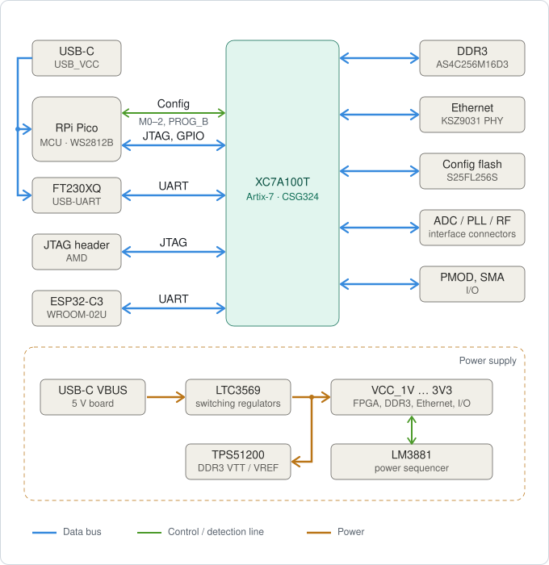

# Artix-7 Digital Board

Stand-alone digital board (`digital_board_v1`) with an AMD Artix-7 XC7A100T for an RF/ADC front-end (ADC, PLL, RF-switch and attenuator control lines on the interface sheet).
Please have a look into the [BOM](bom/ibom.html).

## Contents (KiCad sheets)

| Sheet | Content |
|-------|---------|
| FPGA IO-Bank 1 / 2 | XC7A100T-CSG324 |
| Interface | ADC, PLL and RF control signals to the front-end, PMOD, SMA and 2×20 pin connectors |
| DDR3 Interface | AS4C256M16D3 |
| Ethernet | KSZ9031 Gigabit PHY |
| MCU | RPi Pico (FPGA configuration mode pins, JTAG, GPIOs, power sequencing), WS2812B |
| USB-JTAG / USB-UART | USB-C, FT230X USB-UART, AMD JTAG header |
| RF module | ESP32-C3 module (UART) |
| Board PWR | LTC3569 regulators, TPS51200 DDR termination, LM3881 power sequencer |

