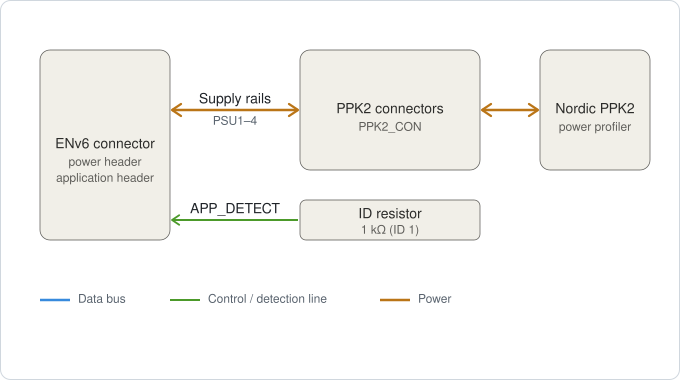

# ENv6 Adapter for Nordic PPK2

Application board (rev 1.0) that connects the supply rails of the ENv6 stack to a Nordic Power Profiler Kit II (PPK2) for high-speed current measurements. Application board ID: **1** (R = 1 kΩ, see the [auto-identification](../readme.md#auto-identification-of-connected-boards)).

The base board routes its supply rails (`PSU1 … PSU4`) through 2×2 headers; this adapter provides PPK2 connectors (`PPK2_CON`) for connecting the PPK2.
