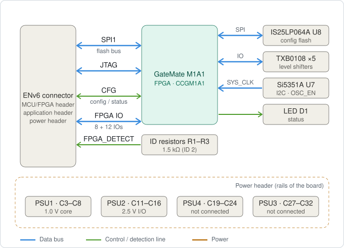

# ENv6 FPGA Board: CologneChip GateMate M1A1/2

FPGA board for the ENv6 base board with the CologneChip GateMate CCGM1A1/2. Intended FPGA board ID: **2** (R_down = 1.5 kΩ). 

## Contents (KiCad sheets)

- `FPGA_Config`: configuration (W25Q16 flash, DIP switches)
- `FPGA_Power`: power supply of the FPGA
- `FPGA_IO_Banks`: IO banks with TXB0108 level shifters, 100 MHz oscillator
- `Connectors`: ENv6 connector (base board and application board)
