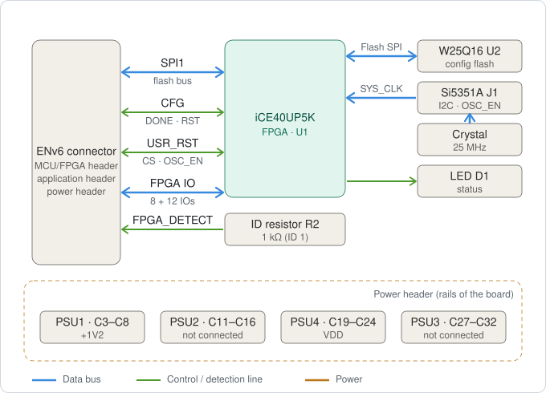

# ENv6 FPGA Board: Lattice iCE40UP5K

FPGA board (shield, rev 1.0, 4-layer PCB) for the ENv6 base board. FPGA board ID: **1** (R2 = 1 kΩ to GND on `FPGA_DETECT`, see the [auto-identification](../readme.md#auto-identification-of-connected-boards)).

## Contents

- Lattice iCE40UP5K-SG48 (U1)
- W25Q16JVUX quad-SPI flash (U2), shared with the MCU via the SPI1/QSPI lines of the connector
- Si5351A clock generator (J1) with 25 MHz crystal (Y1): controlled by the MCU via I2C, output enable `FPGA_OSC_EN`; one output drives the FPGA global clock input (`FPGA_SYS_CLK`, test point TP1), a second output is available at test point TP2
- Status LED (D1, R1 = 750 Ω) on an FPGA IO (`IOT_36B`)
- ID resistor R2 (1 kΩ) on `FPGA_DETECT`
- Pull-ups (R3 … R7, 10 kΩ to `VDD`) on the flash lines `WP`, `HOLD`, `CS` and on `FPGA_PR_~{RST}`, `FPGA_PR_DONE`

## Power Supply

| Rail   | Pins      | Net    | Use                                                  |
|--------|-----------|--------|------------------------------------------------------|
| `PSU1` | C3 … C8   | `+1V2` | iCE40 core (`VCC`) and PLL (`VCCPLL`)                |
| `PSU4` | C19 … C24 | `VDD`  | I/O banks, `VPP_2V5`, flash, Si5351A, pull-ups       |
