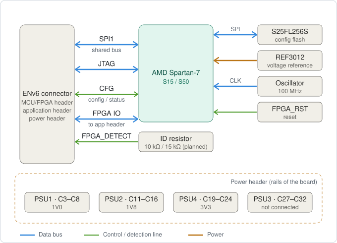

# ENv6 FPGA Board: AMD Spartan-7

FPGA board for the ENv6 base board with an AMD Spartan-7. Intended FPGA board IDs: **7** (S15, 10 kΩ) and **8** (S50, 15 kΩ).

## Contents (KiCad sheets)

- `FPGA_Power_Config`: power supply (REF3012 reference) and configuration (S25FL256S flash)
- `FPGA_IO_Banks`: IO banks, 100 MHz oscillator
- `Connectors`: ENv6 connector (base board and application board)
