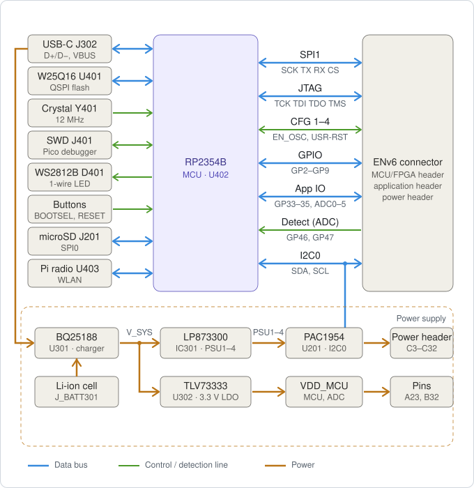

# ENv6 Base Board

Base board of the ENv6 stack. It carries the MCU, wireless, USB, power management and current sensing, and provides the connector to the swappable FPGA board and the optional application board (see the [top-level readme](../readme.md) for the connector description and the auto-identification scheme).

## Contents

| Block (KiCad sheet)                   | Main parts                                                                                                                                                                                                                                                                                                                                      |
|---------------------------------------|-------------------------------------------------------------------------------------------------------------------------------------------------------------------------------------------------------------------------------------------------------------------------------------------------------------------------------------------------|
| MCU (`MCU.kicad_sch`)                 | RP2354B (U402), 12 MHz crystal, W25Q16 QSPI flash (U401, optional with internal-flash variant), Raspberry Pi radio module (U403) for WLAN, WS2812B status LED (D401), BOOTSEL / RESET / one user button, SWD debug connector (J401), 1×4 header for an external FPGA JTAG probe (J402), board detection (two 10 kΩ pull-ups R401/R402 + 1 µF)   |
| Power (`Power.kicad_sch`)             | USB-C (J302), Li-ion battery connector (J_BATT301), BQ25188 charger (U301), LP873300 programmable multi-output supply (IC301, four rails PSU1 … PSU4), TLV73333 3.3 V LDO (U302)                                                                                                                                                                |
| Peripherals (`Peripherals.kicad_sch`) | PAC1954 4-channel current/power monitor (U201, 1 Ω shunts), microSD slot (J201, SPI0), 2×2 headers to route the four supply rails through an external Nordic PPK2                                                                                                                                                                               |
| Connector (`connector.kicad_sch`)     | ENv6 base-board connector (MCU/FPGA header, application header, power header, GND headers)                                                                                                                                                                                                                                                      |

## Interfaces

Pin numbers refer to the connector `B401`; the complete pin tables are in the [top-level readme](../readme.md#connector-of-the-base-board).

| Interface                                            | MCU pins                                                           | Connector pins                    |
|------------------------------------------------------|--------------------------------------------------------------------|-----------------------------------|
| I2C0 (also PAC1954)                                  | GP0 (SDA), GP1 (SCL)                                               | A2, A1                            |
| SPI1 to the FPGA board                               | GP12 (RX), GP13 (CS), GP14 (SCK), GP15 (TX)                        | A18, A17, A20, A19                |
| Quad-SPI data lines                                  | GP16 (IO2), GP17 (IO3)                                             | A22, A21                          |
| JTAG                                                 | GP26 (TCK), GP27 (TDO), GP28 (TDI), GP30 (TMS)                     | A30, A29, A32, A31                |
| Configuration lines `FPGA_CFG_1 … 4`                 | GP19 … GP22                                                        | A26, A25, A28, A27                |
| `MCU-FPGA_CS`, `MCU-FPGA_EN_OSC`, `MCU-FPGA_USR-RST` | GP10, GP11, GP18                                                   | A14, A13, A24                     |
| Unused GPIOs                                         | GP2 … GP9                                                          | A6, A5, A8, A7, A10, A9, A12, A11 |
| Application GPIOs / ADC                              | GP33 … GP35, GP40 … GP45 (ADC0 … ADC5)                             | B31 … B29, B28 … B23              |
| Board detection (ADC)                                | GP46 (`FPGA_DETECT`), GP47 (`APP_DETECT`)                          | B22, B21                          |
| microSD                                              | SPI0: GP36 (RX), GP37 (CS), GP38 (SCK), GP39 (TX)                  | –                                 |
| Radio module                                         | GP23 (`WL_EN`), GP24 (`WL_DATA`), GP25 (`WL_CS`), GP29 (`WL_SCLK`) | –                                 |
| Status LED / button                                  | GP31 (WS2812B), GP32 (user button)                                 | –                                 |

Supply: `VDD_MCU` (3.3 V from the TLV73333) feeds the MCU, `AVDD_ADC` and the detection pull-ups (R401, R402); it is also available on A23 and B32. `VSYS` is on B1 … B4, the four programmable rails `PSU1 … PSU4` on C3 … C32.

BOM: [iBOM](bom/ibom.html)
