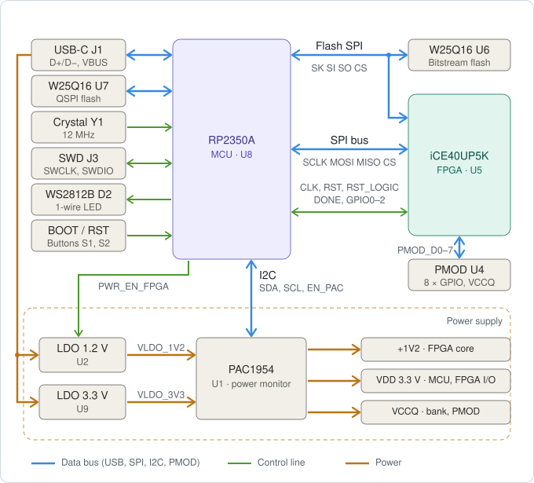

# ENv6.mini

Single-board version of the ENv6 platform (revision 1v1): an MCU, an iCE40UP5K FPGA, a power monitor and a PMOD connector on one PCB. It is the smallest entry point / minimal version to the ENv6 idea (MCU-controlled FPGA configuration and per-rail current measurement).
For further details, please look into the [iBOM v1.1](bom/ibom_1v1.html).

## State
Active. Please use the following firmware from this [repo](https://github.com/es-ude/elasticai_runtime_env6mini).

## Concept
ENv6.mini integrates the essentials of the stack on one PCB:
- **MCU:** an RP2350A (U8) with its own QSPI flash (U7), 12 MHz crystal (Y1), USB-C (J1) for power and data, an SWD connector (J3), BOOT/RST buttons (S1, S2) and a WS2812B status LED (D2). The MCU is the master of the board: it configures the FPGA, controls its power and talks to it over SPI.
- **FPGA:** a Lattice iCE40UP5K (U5) with a bitstream flash (U6, W25Q16). The MCU writes the bitstream to this flash over a dedicated flash SPI (SK, SI, SO, CS) and controls the FPGA with `FPGA_RST` (active low); `FPGA_DONE` reports a finished configuration. The control lines `FPGA_CLK`, `FPGA_RST_LOGIC` (active low) and `FPGA_GPIO0 … 5` as well as a second I2C (`I2C_FPGA_SCL/SDA`) connect MCU and FPGA at runtime.
- **User logic:** the FPGA runs the accelerator; data is exchanged with the MCU over the SPI bus (SCLK, MOSI, MISO, CS). Eight FPGA pins (`PMOD_D0 … 7`) are routed to a PMOD connector (U4) at the I/O voltage `VCCQ` for sensors and peripherals.
- **Power and measurement:** two LDOs generate 1.2 V (U2, FPGA core) and 3.3 V (U9, MCU and FPGA I/O). Their outputs pass a PAC1954 power monitor (U1, 1 Ω shunts, I2C, enable `EN_PAC`), so the MCU can measure current and power of the FPGA rails. The FPGA supply can be switched with `PWR_EN_FPGA`. The FPGA I/O bank and the PMOD run at `VCCQ`.

### Differences to the ENv6 stack

|                      | ENv6.mini                  | ENv6 stack                                                |
|----------------------|----------------------------|-----------------------------------------------------------|
| MCU                  | RP2350A                    | RP2354B                                                   |
| FPGA                 | iCE40UP5K, fixed           | exchangeable FPGA board                                   |
| Power                | USB-C, two fixed LDOs      | USB-C / Li-ion, programmable LP873300 with four rails     |
| Current measurement  | PAC1954 on the LDO outputs | PAC1954 on the four programmable rails (or external PPK2) |
| Extension            | PMOD (8 FPGA I/Os)         | MCU/FPGA, application and power headers                   |
| Board identification | –                          | ID resistors, read by the MCU                             |
| Radio / storage      | –                          | Raspberry Pi radio module, microSD                        |

## Contents

| Block (KiCad sheet)                        | Main parts                                                                                                                              |
|--------------------------------------------|-----------------------------------------------------------------------------------------------------------------------------------------|
| MCU (`mcu.kicad_sch`)                      | RP2350A (U8), 12 MHz crystal (Y1), W25Q16 QSPI flash (U7), SWD connector (J3), WS2812B (D2), BOOT / RST buttons (S1, S2), SMA connector |
| FPGA (`fpga.kicad_sch`)                    | Lattice iCE40UP5K-SG48 (U5), W25Q16 bitstream flash (U6), PMOD with 8 GPIOs at VCCQ (U4), status LED, SMA connector                     |
| Connectors / power (`connector.kicad_sch`) | USB-C (J1), PAC1954 (U1, 1 Ω shunts), LDO 1.2 V TLV73312 (U2), LDO 3.3 V TLV73333 (U9)                                                  |

## Interfaces MCU ↔ FPGA

| Interface              | Signals                                                                                |
|------------------------|----------------------------------------------------------------------------------------|
| SPI bus (user logic)   | SCLK, MOSI, MISO, CS                                                                   |
| Flash SPI (bitstream)  | SK, SI, SO, CS                                                                         |
| Control                | `FPGA_CLK`, `FPGA_RST`, `FPGA_RST_LOGIC`, `FPGA_DONE`, `FPGA_GPIO0 … 5`, `PWR_EN_FPGA` |
| I2C to the FPGA        | `I2C_FPGA_SCL`, `I2C_FPGA_SDA`                                                         |
| I2C to the PAC1954     | `I2C_SDA`, `I2C_SCL`, `EN_PAC`                                                         |

Supply rails: VBUS → LDO 1.2 V (FPGA core), LDO 3.3 V (MCU, FPGA I/O), `VCCQ` (FPGA bank, PMOD).
