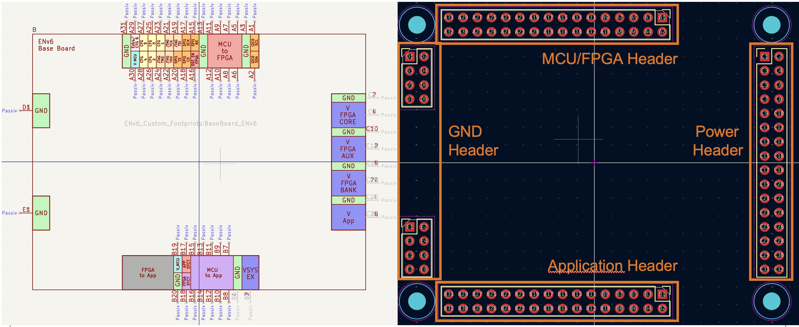

# Elastic Node Hardware Platform v6 (ENv6)
This folder includes the hardware designs and documentation.
The firmware can be used from the elasticAI.runtime ENv5 [repo](https://github.com/es-ude/elastic-ai.runtime.enV5). An extension to ENv6 is coming.
For controlling the hardware from PC with Python CLI, please use the elasticAI.experiment-framework ([repo](https://github.com/es-ude/elastic-ai.experiment-framework)).

## State
Still in development. The connectors are available in our [KiCAD library](https://github.com/es-ude/kicad-library). Available boards are:
- [ ] Base board (USB, MCU, WLAN, ...) - [BOM](main/bom/ibom.html)
- [ ] Measurement board to sense currents using Nordic PKK2
- [ ] FPGA Board with CologneChip GateMate M1A1
- [ ] FPGA Board with CologneChip GateMate M1A2
- [ ] FPGA Board with Lattice ICE40UP5K
- [ ] FPGA Board with AMD Spartan-7 S15
- [ ] FPGA Board with AMD Spartan-7 S50
- [ ] FPGA Board with AMD Artix-7 100T
- [x] Mini Version with Lattice ICE40UP5K - [BOM](mini/bom/ibom_1v1.html)

## Changes to ENV5
### Improvements
- Removing the ESP32 chip and replace with RPi Radio Module
- Upgrading MCU from RP2040 to RP2354B (more GPIOs). Taking the internal flash version is optional.
- Upgrade the current sensor for runtime maintenance from PAC1934 to PAC1954.
- Refactored the power management path (new battery charger, programmable 4-channel power IC).
- Removed all LEDs and replace with one WS2812b LED.
- Add more debugging features to the FPGA (FLASH_DONE, JTAG, ...).
- Reduce number of SPI bus to the FPGA (common bus for flashing and user-logic).
- Add more GPIOs to the FPGA board.
### New features
- Add JTAG functionality by connecting an external device or using DirtyJTAG on the MCU.
- Add a header with unused GPIOs to use in applications.
- Split between main board (MCU, WLAN, USB, Power, PAC-sensor), Application layer and FPGA board.
- Automatic identification of the connected board (FPGA, application - further details below).
- Add a microSD card slot to the design.
- Add connectors for connecting power lines to external high-speed current measurement unit (e.g. Nordic PKK2).

## Auto-Identification of connected boards

The MCU board identifies which swappable FPGA board and an optional application board are attached to this base board.
This is done by measuring the voltage of a resistor divider with the ADC sampling using the RP235x. 
Here, we assume using 1 % resistors (E12 values), 12-bit ADC, total noise/offset/INL error ±16 LSB. 
In order to detect the attached device in the right windows, an oversampling is done (x16) in order to decrease noise during read-out. 
For the worst-case tolerance of both resistors plus ±16 LSB, the minimum gap between windows is ~73 LSB.

### Setup

```
 3.3 V (ADC_AVDD)
     |
   [R_up = 10 kΩ, 1 %]       <- MCU board (fixed)
     |
     +------ ADC pin (+ 100 nF to GND)
     |
   [R_down = ID resistor]    <- FPGA / App board (unique per board)
     |
    GND
```
`Code = 4095 · R_down / (R_down + R_up)`


### ID Table for the FPGA Boards

| ID   | R_down          | Nominal code | Window (min … max)   | Target                    |
|------|-----------------|--------------|----------------------|---------------------------|
| –    | short to GND    | 0            | 0 … 16 → fault       | None                      |
| 1    | 1.0 kΩ          | 372          | 350 … 395            | Lattice ICE40UP5K         |
| 2    | 1.5 kΩ          | 534          | 509 … 560            | CologneChip GateMate M1A1 |
| 3    | 2.2 kΩ          | 738          | 710 … 767            | CologneChip GateMate M1A2 |
| 4    | 3.3 kΩ          | 1016         | 985 … 1047           | reserved                  |
| 5    | 4.7 kΩ          | 1309         | 1275 … 1343          | reserved                  |
| 6    | 6.8 kΩ          | 1658         | 1622 … 1693          | reserved                  |
| 7    | 10 kΩ           | 2048         | 2011 … 2084          | AMD Spartan-7 S15         |
| 8    | 15 kΩ           | 2457         | 2421 … 2493          | AMD Spartan-7 S50         |
| 9    | 22 kΩ           | 2815         | 2781 … 2849          | AMD Artix-7-100T          |
| 10   | 33 kΩ           | 3143         | 3112 … 3173          | reserved                  |
| 11   | 47 kΩ           | 3377         | 3349 … 3404          | reserved                  |
| 12   | 68 kΩ           | 3570         | 3545 … 3595          | reserved                  |
| 13   | 100 kΩ          | 3723         | 3700 … 3745          | reserved                  |
| 14   | 150 kΩ          | 3839         | 3818 … 3860          | reserved                  |
| –    | open (no board) | ≈ 0          | > 3900 → no board    | None                      |

### ID Table for the Application Boards

| ID   | R_down          | Nominal code | Window (min … max)   | Target                            |
|------|-----------------|--------------|----------------------|-----------------------------------|
| –    | short to GND    | 0            | 0 … 16 → fault       | None                              |
| 1    | 1.0 kΩ          | 372          | 350 … 395            | Measurement Board for Nordic PKK2 |
| 7    | 10 kΩ           | 2048         | 2011 … 2084          | Real application board            |
| –    | open (no board) | ≈ 0          | > 3900 → no board    | None                              |

## Configuration of the Connector IOs
The following Figure shows the symbol of the connector header (left) and their layout (right) used in KiCAD. 
You find different types of symbol in the KiCAD library which have a common IO placement (base board, FPGA shield, application).

The headers are grouped into three segments:
- power (voltage: right, ground: left) - Access up to five voltages (V_SYS = System Raw Voltage, V_FPGA_CORE = FPGA Core Voltage, V_FPGA_AUX = Aux Power Supply, V_FPGA_BANK = FPGA Bank Voltage, V_APP = Additional LDO output with programmable output voltage (0.8 ... 3.6 V @ 300 mA)).
- Application Header (down) - Configurable MCU (x6) / FPGA (x12) GPIOs for application + V_MCU for IO translation + Detection pins for FPGA and Application
- Configuration Header (up) - Detailed description below in the table.
 
| Pin | Short Name    | Type  | Function                                                                  | 
|-----|---------------|-------|---------------------------------------------------------------------------|
| A32 | GND           | Power | Ground connection                                                         | 
| A31 | GND           | Power | Ground connection                                                         | 
| A30 | V_MCU         | Power | Power Supply from the MCU for driving IO signals (not using for powering) | 
| A29 | Extra / CFG 6 | I/O   |                                                                           | 
| A28 | CFG 4         | I/O   |                                                                           | 
| A27 | CFG 5         | I/O   |                                                                           | 
| A26 | CFG 2         | I/O   |                                                                           | 
| A25 | CFG 3         | I/O   |                                                                           | 
| A24 | JTAG-TMS      | I/O   | Data Input line for JTAG                                                  | 
| A23 | CFG 1         | I/O   |                                                                           | 
| A22 | JTAG-TDO      | I/O   | Data Output line for JTAG                                                 | 
| A21 | JTAG-TCK      | I/O   | Output (Shield)                                                           |                                                                           | 
| A20 | SPI1-TX       | I/O   | SPI TX (MOSI from MCU perspective)                                        | 
| A19 | JTAG-TDI      | I/O   | Data Input line for JTAG                                                  | 
| A18 | SPI1-CS       | I/O   | SPI Chip-Select line for the Flash Device                                 | 
| A17 | SPI1-SCK      | I/O   | SPI Clock Line                                                            | 
| A16 | OSC-EN        | I/O   | Enable line for the FPGA oscillator device                                | 
| A15 | SPI1-RX       | I/O   | SPI-RX (MISO from MCU perspective)                                        | 
| A14 | GND           | Power | Ground connection                                                         | 
| A13 | GND           | Power | Ground connection                                                         | 
| A12 | MCU_FPGA_G0   | I/O   |                                                                           | 
| A11 | MCU_FPGA_G1   | I/O   |                                                                           | 
| A10 | MCU_FPGA_G2   | I/O   |                                                                           | 
| A09 | MCU_FPGA_G3   | I/O   |                                                                           | 
| A08 | MCU_FPGA_G4   | I/O   |                                                                           | 
| A07 | MCU_FPGA_G5   | I/O   |                                                                           | 
| A06 | MCU_FPGA_G6   | I/O   |                                                                           | 
| A05 | MCU_FPGA_G7   | I/O   |                                                                           | 
| A04 | GND           | Power | Ground connection                                                         | 
| A03 | GND           | Power | Ground connection                                                         | 
| A02 | I2C0_SDA      | I/O   | I2C Data line                                                             | 
| A01 | I2C0_SCL      | I/O   | I2C Clock line                                                            |
