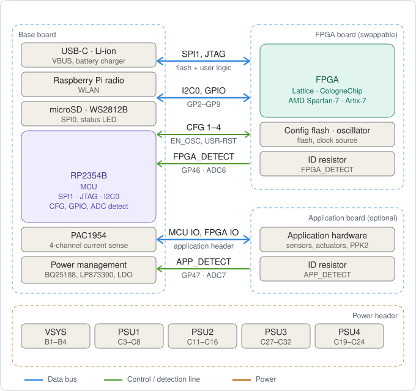
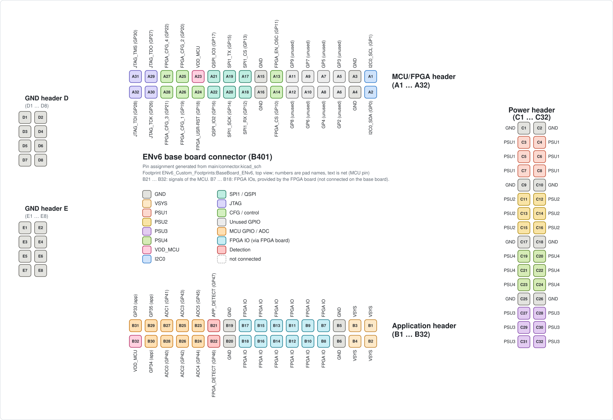

# Elastic Node Hardware Platform v6 (ENv6)

This folder contains the hardware designs (KiCad) and documentation of the Elastic Node v6 platform.

- Firmware: the elasticAI.runtime ENv5 [repo](https://github.com/es-ude/elastic-ai.runtime.enV5) can be used as a starting point. An extension for ENv6 is coming.
- Control from a PC (Python CLI): [elasticAI.experiment-framework](https://github.com/es-ude/elastic-ai.experiment-framework).
- Connector symbols and footprints are part of our [KiCad library](https://github.com/es-ude/kicad-library).

## Concept

ENv6 is a **modular stack** for running and measuring neural-network accelerators on small FPGAs in an energy-constrained setting. The ENv5 monolith is split into three swappable layers that are connected through standardized board-to-board headers:

| Layer                            | Purpose                                                                                                                                                            | Folder                                                                                                                           |
|----------------------------------|--------------------------------------------------------------------------------------------------------------------------------------------------------------------|----------------------------------------------------------------------------------------------------------------------------------|
| **Base board**                   | RP2354B MCU, Raspberry Pi radio module (WLAN), USB-C, Li-ion charger, programmable power supply, 4-channel current sensor (PAC1954), microSD, WS2812B status LED   | [`main`](main/readme.md)                                                                                                         |
| **FPGA board** (swappable)       | One FPGA (+ configuration flash, clock, level shifting as needed); identifies itself to the MCU with an ID resistor                                                | [`fpga_lattice`](fpga_lattice/readme.md), [`fpga_gatemate`](fpga_gatemate/readme.md), [`fpga_spartan7`](fpga_spartan7/readme.md) |
| **Application board** (optional) | Sensors, actuators or measurement hardware; identifies itself with an ID resistor                                                                                  | [`adapter_ppk2`](adapter_ppk2/readme.md)                                                                                         |



The MCU configures the FPGA (flash/bitstream over SPI1, JTAG, configuration lines), supplies it with four programmable supply rails (`PSU1 … PSU4`) and measures their current. The attached FPGA and application boards are detected automatically (see [Auto-identification](#auto-identification-of-connected-boards)).

In addition, [`mini`](mini/readme.md) is a single-board version (see [ENv6.mini](#env6mini)) and [`1_dev_artix`](1_dev_artix/readme.md) is a stand-alone Artix-7 development board.

## State

Still in development. Overview of the boards in this folder:

| Board                            | Folder                           | State          | Infos                                                                                                |
|----------------------------------|----------------------------------|----------------|------------------------------------------------------------------------------------------------------|
| Base board                       | [`main`](main)                   | In development | [readme](main/readme.md), [iBOM](main/bom/ibom.html)                                                 |
| PPK2 measurement adapter         | [`adapter_ppk2`](adapter_ppk2)   | In development | [readme](adapter_ppk2/readme.md)                                                                     |
| FPGA board Lattice iCE40UP5K     | [`fpga_lattice`](fpga_lattice)   | In development | [readme](fpga_lattice/readme.md), [iBOM](fpga_lattice/bom/ibom.html)                                 |
| FPGA board GateMate M1A1         | [`fpga_gatemate`](fpga_gatemate) | In development | [readme](fpga_gatemate/readme.md)                                                                    |
| FPGA board GateMate M1A2         | –                                | In development | –                                                                                                    |
| FPGA board Spartan-7 (S15 / S50) | [`fpga_spartan7`](fpga_spartan7) | In development | [readme](fpga_spartan7/readme.md)                                                                    |
| FPGA board Artix-7 100T          | –                                | Not started    | –                                                                                                    |
| Artix-7 development board        | [`1_dev_artix`](1_dev_artix)     | Deprecated     | [readme](1_dev_artix/readme.md), [iBOM](1_dev_artix/bom/ibom.html)                                   |
| **ENv6.mini** (iCE40UP5K)        | [`mini`](mini)                   | Active         | [readme](mini/readme.md), [iBOM v1.1](mini/bom/ibom_1v1.html), [v1.0](mini/bom/ibom_1v0.html)        |

## Changes to ENv5
### Improvements
- Removed the ESP32 and replaced it with a Raspberry Pi radio module.
- Upgraded the MCU from RP2040 to RP2354B (more GPIOs). The variant with internal flash is optional (external W25Q16 flash is on the board).
- Upgraded the current sensor from PAC1934 to PAC1954 (four channels on the base board).
- Refactored the power path: new battery charger (BQ25188), programmable 4-output power IC (LP873300), 3.3 V LDO for the MCU.
- Removed all status LEDs of the base board and replaced them with a single WS2812B. (FPGA boards may carry their own status LED.)
- More debugging features towards the FPGA (JTAG, configuration/status lines, ...).
- Reduced the number of SPI buses to the FPGA (SPI1 is shared between flashing and user logic).
- More GPIOs towards the FPGA board.

### New features
- JTAG towards the FPGA board via an external probe on the base board header. Running DirtyJTAG on the MCU is planned (the schematic marks the external header as a temporary solution until then).
- Header with unused MCU GPIOs for applications.
- Split into base board (MCU, WLAN, USB, power, PAC sensor), optional application board and swappable FPGA board.
- Automatic identification of the connected FPGA board and application board (see below).
- microSD card slot (SPI0 of the MCU).
- Pin headers to route the supply rails through an external high-speed current measurement unit (e.g. Nordic PPK2) instead of the on-board PAC1954.

## Auto-identification of connected boards

The base board identifies which swappable FPGA board and which optional application board is attached. Each board carries one resistor to GND (`R_down`); on the base board a 10 kΩ pull-up (`R_up`) to `VDD_MCU` forms a divider that is sampled by the 12-bit ADC of the RP2354B (`FPGA_DETECT` on GP46/ADC6 for the FPGA board, `APP_DETECT` on GP47/ADC7 for the application board, each with a 1 µF capacitor to GND). `VDD_MCU` also supplies `AVDD_ADC`, so the measurement is ratiometric.

Assumptions: 1 % resistors (E12 values), 12-bit ADC, total noise/offset/INL error ±16 LSB, 16× oversampling. For the worst-case tolerance of both resistors plus ±16 LSB, the minimum gap between windows is ~73 LSB. Because of the 10 kΩ / 1 µF RC filter (τ ≈ 10 ms), wait at least ~50 ms after power-up before sampling.

### Setup

```
 VDD_MCU (3.3 V)
     |
   [R_up = 10 kΩ, 1 %]       <- base board (fixed)
     |
     +------ ADC pin (+ 1 µF to GND)
     |
   [R_down = ID resistor]    <- FPGA / application board (unique per board)
     |
    GND
```
`Code = 4095 · R_down / (R_down + R_up)`

### ID table for the FPGA boards

| ID   | R_down          | Nominal code | Window (min … max)   | Target                    |
|------|-----------------|--------------|----------------------|---------------------------|
| –    | short to GND    | 0            | 0 … 16 → fault       | None                      |
| 1    | 1.0 kΩ          | 372          | 350 … 395            | Lattice iCE40UP5K         |
| 2    | 1.5 kΩ          | 534          | 509 … 560            | CologneChip GateMate M1A1 |
| 3    | 2.2 kΩ          | 738          | 710 … 767            | CologneChip GateMate M1A2 |
| 4    | 3.3 kΩ          | 1016         | 985 … 1047           | reserved                  |
| 5    | 4.7 kΩ          | 1309         | 1275 … 1343          | reserved                  |
| 6    | 6.8 kΩ          | 1658         | 1622 … 1693          | reserved                  |
| 7    | 10 kΩ           | 2048         | 2011 … 2084          | AMD Spartan-7 S15         |
| 8    | 15 kΩ           | 2457         | 2421 … 2493          | AMD Spartan-7 S50         |
| 9    | 22 kΩ           | 2815         | 2781 … 2849          | AMD Artix-7 100T          |
| 10   | 33 kΩ           | 3143         | 3112 … 3173          | reserved                  |
| 11   | 47 kΩ           | 3377         | 3349 … 3404          | reserved                  |
| 12   | 68 kΩ           | 3570         | 3545 … 3595          | reserved                  |
| 13   | 100 kΩ          | 3723         | 3700 … 3745          | reserved                  |
| 14   | 150 kΩ          | 3839         | 3818 … 3860          | reserved                  |
| –    | open (no board) | ≈ 4095       | > 3900 → no board    | None                      |

### ID table for the application boards

| ID   | R_down          | Nominal code | Window (min … max)   | Target                            |
|------|-----------------|--------------|----------------------|-----------------------------------|
| –    | short to GND    | 0            | 0 … 16 → fault       | None                              |
| 1    | 1.0 kΩ          | 372          | 350 … 395            | Measurement board for Nordic PPK2 |
| 7    | 10 kΩ           | 2048         | 2011 … 2084          | Real application board            |
| –    | open (no board) | ≈ 4095       | > 3900 → no board    | None                              |

## Connector of the base board

The base board connects to the other boards with four headers (KiCad symbol `ENv6_Custom_Symbols:BaseBoard_ENv6`, footprint `ENv6_Custom_Footprints:BaseBoard_ENv6`, instance `B401` in [`main/connector.kicad_sch`](main/connector.kicad_sch)). The tables below are generated from that schematic (pin → net → MCU pin).



- **MCU/FPGA header** (A1 … A32): I2C0, SPI1, JTAG, configuration lines and general-purpose MCU GPIOs towards the FPGA board.
- **Application header** (B1 … B32): `VSYS`, detection lines, MCU GPIOs/ADC inputs for the application board and `VDD_MCU`. Pins B7 … B18 do not exist on the base-board symbol. According to the schematics of the FPGA boards, the FPGA IOs for the application board are provided by the FPGA board itself (B row of the `FPGABoard_ENv6` symbol).
- **Power header** (C1 … C32): the four programmable rails of the LP873300 (`PSU1 … PSU4`, six pins each, separated by GND pins). Their use (core, auxiliary, bank, ...) is defined by the FPGA board. All four rails pass the PAC1954 current sensor (or an external PPK2).
- **GND headers** (D1 … D8, E1 … E8): additional ground connections.

### MCU/FPGA header
| Pin | Net              | MCU pin | Function                                                                      |
|-----|------------------|---------|-------------------------------------------------------------------------------|
| A1  | I2C0_SCL         | GP1     | I2C clock                                                                     |
| A2  | I2C0_SDA         | GP0     | I2C data                                                                      |
| A3  | GND              |         | Ground                                                                        |
| A4  | GND              |         | Ground                                                                        |
| A5  | Unused_GP3       | GP3     | General-purpose MCU GPIO                                                      |
| A6  | Unused_GP2       | GP2     | General-purpose MCU GPIO                                                      |
| A7  | Unused_GP5       | GP5     | General-purpose MCU GPIO                                                      |
| A8  | Unused_GP4       | GP4     | General-purpose MCU GPIO                                                      |
| A9  | Unused_GP7       | GP7     | General-purpose MCU GPIO                                                      |
| A10 | Unused_GP6       | GP6     | General-purpose MCU GPIO                                                      |
| A11 | Unused_GP9       | GP9     | General-purpose MCU GPIO                                                      |
| A12 | Unused_GP8       | GP8     | General-purpose MCU GPIO                                                      |
| A13 | MCU-FPGA_EN_OSC  | GP11    | Enable for the FPGA oscillator                                                |
| A14 | MCU-FPGA_CS      | GP10    | Additional chip select towards the FPGA                                       |
| A15 | GND              |         | Ground                                                                        |
| A16 | GND              |         | Ground                                                                        |
| A17 | SPI1_CS          | GP13    | SPI1 chip select                                                              |
| A18 | SPI1_RX          | GP12    | SPI1 RX (MISO from the MCU perspective)                                       |
| A19 | SPI1_TX          | GP15    | SPI1 TX (MOSI from the MCU perspective)                                       |
| A20 | SPI1_SCK         | GP14    | SPI1 clock                                                                    |
| A21 | QSPI_IO3         | GP17    | Quad-SPI data line 3                                                          |
| A22 | QSPI_IO2         | GP16    | Quad-SPI data line 2                                                          |
| A23 | VDD_MCU          |         | MCU I/O supply (3.3 V) as reference for driving IO signals (not for powering) |
| A24 | MCU-FPGA_USR-RST | GP18    | User reset towards the FPGA                                                   |
| A25 | FPGA_CFG_2       | GP20    | Configration Feedback with State (e.g. `DONE`)                                |
| A26 | FPGA_CFG_1       | GP19    | Configuration Reset to control the FPGA                                       |
| A27 | FPGA_CFG_4       | GP22    | Configuration for further control (like `Power-On-Reset` in CCGM1Ax)          |
| A28 | FPGA_CFG_3       | GP21    | Configuration Control Line (like `FAILED` in CCGM1Ax, or `INIT`in AMDs FPGA)  |
| A29 | JTAG_TDO         | GP27    | JTAG test data out (from the FPGA)                                            |
| A30 | JTAG_TCK         | GP26    | JTAG test clock                                                               |
| A31 | JTAG_TMS         | GP30    | JTAG test mode select                                                         |
| A32 | JTAG_TDI         | GP28    | JTAG test data in (to the FPGA)                                               |

### Application header
| Pin       | Net         | MCU pin     | Function                                                     |
|-----------|-------------|-------------|--------------------------------------------------------------|
| B1 … B4   | VSYS        |             | System voltage (battery / USB)                               |
| B5, B6    | GND         |             | Ground                                                       |
| B7 … B18  | –           |             | Not present on the base-board symbol                         |
| B19, B20  | GND         |             | Ground                                                       |
| B21       | APP_DETECT  | GP47 (ADC7) | Detection of the application board                           |
| B22       | FPGA_DETECT | GP46 (ADC6) | Detection of the FPGA board                                  |
| B23       | GP45_ADC5   | GP45        | MCU GPIO / ADC5                                              |
| B24       | GP44_ADC4   | GP44        | MCU GPIO / ADC4                                              |
| B25       | GP43_ADC3   | GP43        | MCU GPIO / ADC3                                              |
| B26       | GP42_ADC2   | GP42        | MCU GPIO / ADC2                                              |
| B27       | GP41_ADC1   | GP41        | MCU GPIO / ADC1                                              |
| B28       | GP40_ADC0   | GP40        | MCU GPIO / ADC0                                              |
| B29       | MCU-AP_GP35 | GP35        | MCU GPIO                                                     |
| B30       | MCU-AP_GP34 | GP34        | MCU GPIO                                                     |
| B31       | MCU-AP_GP33 | GP33        | MCU GPIO                                                     |
| B32       | VDD_MCU     |             | MCU I/O supply (3.3 V) as reference for IO level translation |

### Power header and GND headers
| Pin              | Net    |
|------------------|--------|
| C1, C2           | GND    |
| C3 … C8          | PSU1   |
| C9, C10          | GND    |
| C11 … C16        | PSU2   |
| C17, C18         | GND    |
| C19 … C24        | PSU4   |
| C25, C26         | GND    |
| C27 … C32        | PSU3   |
| D1 … D8, E1 … E8 | GND    |
